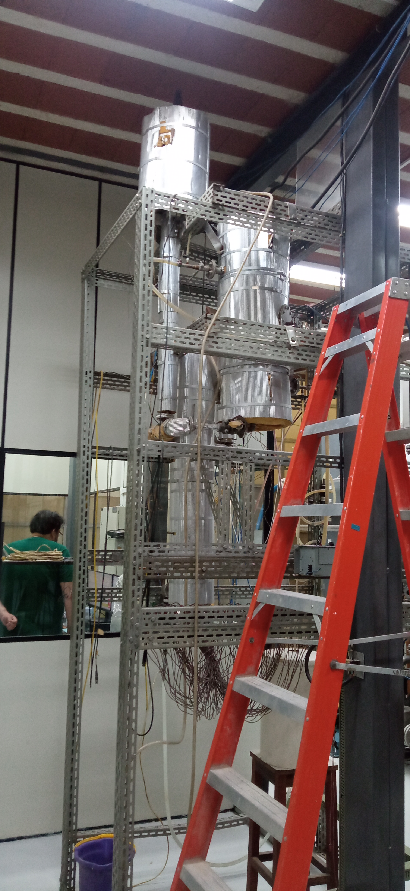

As the world races to decarbonize energy systems, advanced nuclear reactors
emerge as a critical solution, delivering reliable, carbon-free power. A key
innovation in these reactors is the use of natural circulation, a naturally
occurring phenomenon in fluids under a gravitational field that requires no
external influence. Leveraging this phenomenon allows reactors to cool passively
without mechanical pumps, making them inherently safer.

Nonetheless, due to the complex, non-linear, multi-physics interactions that
govern this fluid-flow phenomenon, computational simulations of such systems are
often very expensive, making it challenging to design and monitor reactors that
rely on it.

That is why, in research conducted as part of my Master's at the **National
Laboratory for Scientific Computing**, we explored Physics-Informed Machine
Learning (PIML) to model natural circulation, aiming to measure potential
speedups and develop practical implementation strategies.

To do this, we combined experimental data from the Natural Circulation Circuit
experiment at the **Institute for Nuclear Engineering** (IEN, 🇧🇷) — a 1:4
height-scale model inspired by the AP600 reactor—with numerical simulations
from OpenFOAM to train and validate PIML architectures, including PINNs
(Physics-Informed Neural Networks) and DeepONets, using frameworks such as
**PyTorch, JAX, and DeepXDE**.

We found that applying PINNs to this problem posed major challenges. Because
the formulation behaved as an ill-posed problem for this physics regime,
training often suffered from spurious local minima, making PINNs impractical
for high-stakes applications like nuclear reactors. By contrast, Deep Operator
Networks (and related operator architectures) exhibited a much more stable
profile.

Because experimental challenges could not be resolved before the end of my
Master's, we concluded this line of work on the circuit and pivoted to a simpler
system.

{fig-alt="Natural Circulation loop at IEN" width=100%}
