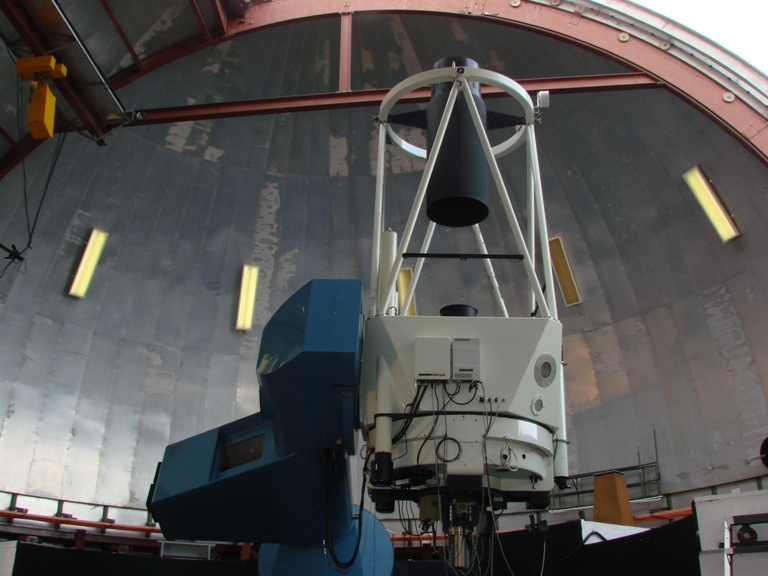

Stellar Variability studies generates significant volumes of data reaching
thousands of images per night, with hundreds of gigabytes, making it impractical
to process and analyse with traditional methods, so to process and analyse an
entire observational campaing with 10 nights for the Wild Duck Stellar Cluster
during my scientific initiation, i developed the **Wild Duck Pipeline: A Python
pipeline for automated CCD image reduction and time-series photometry tested
with the Wild Duck cluster (M11) data.**

The Wild Duck Pipeline takes a folder of raw FITS frames from an observing night
and produces calibrated, aligned, combined images and photometry tables. I built
it during a scientific-initiation project to replace a manual IRAF workflow
with a scriptable Python pipeline; it was later used by a research group partner
during his master's research using observations from the OPD/LNA 0.6 m and 1.6
m telescopes.

The code is split into small, composable modules (`pre_processing`,
`inspection`, `photometry`, `astrometry`) so each stage can be used on its own
or scripted end-to-end. The pipeline covers the path from raw data to light
curves:

- Organizes a night run from FITS headers and writes per-frame metadata and
  night logs.
- Performs overscan/trim correction, master bias and normalized flat
  generation, and CCD calibration with `ccdproc`.
- Aligns frames with `astroalign` and median-combines time-series blocks.
- Extracts image statistics, sky background/sigma, and Moffat FWHM for quality
  inspection.
- Runs `DAOStarFinder` source detection, aperture photometry, and differential
  photometry against stable reference stars.
- Adds RA/Dec coordinates from a WCS.

**Stack:** Python 3.12, `astropy`, `ccdproc`, `astroalign`, `photutils`,
`pandas`, `numpy`, `matplotlib`, and `scikit-image`, with a reproducible
environment managed by `uv` and `uv.lock`.

**Status:** research prototype, archived. It is tailored to OPD/LNA header and
filename conventions and is not a general-purpose pipeline. The repository
includes the design document, exploratory notebooks, and the
scientific-initiation reports.

**Code:** <https://github.com/jpssrocha/WildDuckPipe>

